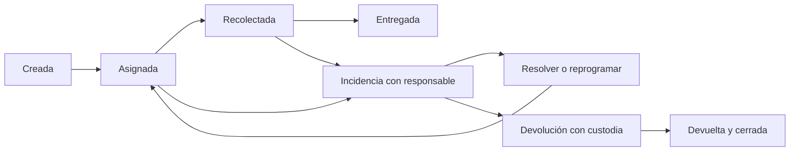

# PilotGo — análisis integral y propuesta de evolución de última milla

**Fecha:** 11 de noviembre de 2026, America/Santo_Domingo.
**Backend/panel revisado:** `master`, `da48f5294a3359cc8febc315793fb3f4c3cd03b6`.
**App revisada:** `main`, `0f42e391e1336eb39404eeeb5c598b00491b43a5`, versión 1.1.0+2.

## 1. Diagnóstico ejecutivo

PilotGo tiene una base funcional para crear órdenes, asignarlas, recogerlas y entregarlas. Ya existen sesiones móviles renovables, códigos de cuatro dígitos ligados a la orden, separación entre tenants y controles de concurrencia para partes centrales de la entrega.

El siguiente trabajo debe completar la operación diaria y el panel administrativo. Hay funcionalidades anunciadas por la interfaz que no tienen implementación, datos de carga escritos como valores fijos y reglas administrativas que pueden impedir terminar entregas. Los recorridos de excepción —dirección modificada, piloto retirado, cliente ausente, mala conexión, reintento y devolución— todavía no forman un circuito completo.

**Recomendación principal:** primero cerrar coherencia, bajas seguras, duplicados e historial; después construir centro de operaciones, incidencias y comunicación; luego cobros, liquidaciones y optimización de rutas. Los nuevos módulos deben completar recorridos entre app y panel, con permisos y pruebas compartidos.

No asigno un porcentaje de avance: un número ocultaría diferencias importantes entre módulos funcionales, parciales y ausentes.

## 2. Alcance y cómo interpretar los resultados

- Se revisaron controladores, servicios, entidades, permisos, vistas Razor y JavaScript del backend; el inventario contiene 52 vistas Razor, incluyendo componentes y layouts.
- Se revisaron autenticación, comercio, piloto, navegación, red, almacenamiento, mapas/GPS, escáner y pruebas de la app Flutter.
- Los hallazgos describen el código local de esas revisiones. No se inició sesión en producción, no se consultaron pedidos reales y no se realizó una inspección visual del panel en navegador o de la app en un teléfono durante esta auditoría.
- Las consecuencias descritas por lectura de código se distinguen de las pruebas ejecutadas. Un defecto encontrado en un caso límite no implica que todas las entregas actuales estén fallando.
- No se modificó el código del producto, no se generó otro APK y no se publicó esta auditoría. Este documento es el entregable.
- La confirmación previa del usuario de que la actualización funcionó respalda su experiencia de uso; no sustituye mediciones de carga o pruebas de todos los módulos.

### Pruebas repetidas en esta auditoría

| Comprobación | Resultado |
|---|---|
| Backend, pruebas existentes con SQLite, binarios locales correspondientes a la revisión | **27 correctas, 1 omitida específica de SQL Server.** |
| Flutter, pruebas existentes | **19 correctas.** HTTP, almacenamiento nativo y mapa se simulan según cada prueba. |
| Migración/SQL Server | No se repitió ahora. La evidencia de la entrega anterior registra 28 correctas en SQL Server. |
| Recursos del panel | Verificación estática: cuatro rutas distintas de JavaScript inexistentes y tres destinos principales de SuperAdmin sin acción/vista. |
| Teléfono, GPS, cámara, notificaciones y panel visual | No se volvieron a validar físicamente en esta auditoría. |

La primera ejecución SQLite tuvo 26 correctas, 1 omitida y 1 fallo debido al proveedor Windows EventLog sin permiso de escritura en el entorno restringido. Se repitió sin cambiar código, usando `Logging__EventLog__LogLevel__Default=None` únicamente en ese proceso; pasó la prueba de restricción de códigos y la batería completa. No se interpreta ese fallo de permisos como una regresión del generador de códigos.

La ejecución restringida de Flutter quedó bloqueada; se detuvo esa ejecución y se ejecutaron las mismas pruebas con acceso autorizado a la caché del SDK. No se actualizó Flutter.

Referencias: [Login.Tests/PilotGoFactory.cs:31](C:/Users/Fernelis/source/repos/Login-PilotoGot/Login.Tests/PilotGoFactory.cs:31), [Login.Tests/FleetFlowTests.cs:16](C:/Users/Fernelis/source/repos/Login-PilotoGot/Login.Tests/FleetFlowTests.cs:16), [docs/qa/release-1.1.0.json](C:/Users/Fernelis/source/repos/Login-PilotoGot/docs/qa/release-1.1.0.json), [app/test/session_test.dart:24](C:/Users/Fernelis/Desktop/pilotGOapp/test/session_test.dart:24), [app/test/short_codes_test.dart:76](C:/Users/Fernelis/Desktop/pilotGOapp/test/short_codes_test.dart:76).

**Límite importante de cobertura:** el escenario existente de veinte pilotos y cuarenta comercios prepara sus altas directamente en la base de pruebas. Comprueba entregas y aislamiento, pero no demuestra que los formularios de alta, cuotas, bajas, scripts o navegación administrativos funcionen correctamente. Tampoco certifica capacidad del servidor público.

## 3. Qué existe hoy

| Área / usuario | Estado | Implementación y cierre pendiente |
|---|---|---|
| Autenticación móvil | Funcional en el alcance probado | Login, refresh rotatorio, revocación por dispositivo, contraseña recordada opcional. Falta autoservicio de cuenta/recuperación y gestión visible de dispositivos. |
| Códigos y entrega normal | Funcional en el alcance probado | A/B/C nuevos de cuatro dígitos, códigos antiguos conservados, B y C validados con orden/piloto/tenant/estado. Mantener esta compatibilidad. |
| Asignación automática | Funcional básica | Ofertas, aceptación y rechazo, una automática activa por piloto. Falta política por zona/carga/frescura GPS, vencimiento de oferta y escalamiento. |
| Asignación manual | Funcional básica | Varias asignaciones y actualización del piloto en su pantalla principal. Faltan transferencia, rescate, disponibilidad fiable y control de carga. |
| Comercio móvil | Parcial | Destinatarios, alta, comprobante y lista de órdenes. Faltan sincronización automática, historial consultable, filtros, cotización, incidencias y cobros. |
| Piloto móvil | Parcial | Trabajo activo, recogida/entrega, llamada y navegación externa. Faltan menú, historial, jornada, incidencias, ingresos y funcionamiento con mala conexión. |
| Mapa/GPS | Parcial | Reporte de posición y mapa administrativo con consulta periódica. Faltan frescura, seguimiento independiente de ofertas, trazas, calidad y continuidad según jornada. |
| Panel SuperAdmin | Parcial | CRUD de planes/empresas y alta de gestor. Dashboard, Finanzas y Auditoría Global no tienen implementación detrás del menú. |
| Panel gestor/despacho | Parcial | Comercios/pilotos, primera asignación, filtros, mapa y estadísticas con consultas reales. Faltan actualización de despacho, historial, recuperación de órdenes y reglas uniformes. |
| Usuarios y permisos | Parcial | Roles y vínculos por comercio existentes; navegación y mantenimiento fragmentados. Falta invitar, revocar pertenencia, separar responsabilidades y registrar cambios. |
| Suscripciones SaaS | Parcial | Planes, cuotas y fechas guardadas. No hay ciclo completo de cobros, mora, gracia, renovación y límites efectivos. |
| Estadísticas | Parcial | Series, estados, rankings y promedios reales. Fechas, zona horaria, cohortes y rangos necesitan definición consistente. |
| Incidencias/devoluciones | Ausente como recorrido completo | Existe el enum Incidente, pero no las transiciones, evidencias, responsables y resolución integral. |
| Finanzas operativas | Ausente | El precio de una orden no constituye cobro, caja, deuda, comisión ni liquidación. |
| Destinatario final | Ausente como experiencia propia | Sin enlace seguro de seguimiento, avisos, ETA o comunicación automatizada del código C. |
| Notificaciones / trabajo sin conexión | Ausente como módulo | El polling de la pantalla del piloto y la persistencia de sesión no equivalen a push ni a una cola local de trabajo. |

## 4. Hallazgos que deben corregirse primero

Prioridades: **Alta** puede duplicar trabajo, cambiar una entrega o bloquear su terminación; **Media** afecta control, información, acceso o ingresos; **Baja** completa consistencia visual/usabilidad. Son prioridades propuestas para el backlog, no incidentes confirmados en producción.

### H01. Un reintento puede crear dos órdenes — Alta

El alta móvil hace POST y luego GET del QR en un mismo bloque de éxito/error. Si el POST ya confirmó y el QR falla, conserva el formulario y habilita otra creación. Además, el API no recibe una clave que identifique el mismo intento de creación.

**Ejemplo:** se crea la orden 105; se pierde la respuesta o falla cargar su QR; el comercio vuelve a tocar Crear y aparece la 106 para la misma entrega. La transacción actual protege la escritura de cada orden, pero no reconoce ambos intentos como uno.

**Mejora:** generar un identificador de operación en el cliente; exigir unicidad por tenant y operación en el servidor; guardar y devolver el resultado original al repetir. Separar “orden creada” de “comprobante pendiente de cargar”. Antes de reintentar, recuperar el estado confirmado.

**Aceptación:** misma operación repetida o concurrente produce una orden, un consumo de cuota y un evento de creación; un GET de QR fallido solo reintenta el comprobante.

Evidencia: [app/lib/features/tienda/presentation/crear_orden_screen.dart:77](C:/Users/Fernelis/Desktop/pilotGOapp/lib/features/tienda/presentation/crear_orden_screen.dart:77), [app/lib/features/tienda/presentation/crear_orden_screen.dart:84](C:/Users/Fernelis/Desktop/pilotGOapp/lib/features/tienda/presentation/crear_orden_screen.dart:84), [Login/Controllers/Api/TiendaApiController.cs:21](C:/Users/Fernelis/source/repos/Login-PilotoGot/Login/Controllers/Api/TiendaApiController.cs:21), [Login/Application/Services/OrdenService.cs:24](C:/Users/Fernelis/source/repos/Login-PilotoGot/Login/Application/Services/OrdenService.cs:24).

### H02. Cambiar un contacto modifica órdenes anteriores — Alta

La orden apunta al destinatario compartido y la app consulta su dirección, teléfono y mapa actuales. Editar ese contacto para un pedido futuro modifica lo mostrado en pedidos ya creados, incluso históricos, mientras su precio/distancia siguen siendo los originales.

**Mejora:** guardar una copia de recogida, destino, contacto, instrucciones y condiciones comerciales al crear la orden. Un cambio posterior de entrega debe ser una acción explícita, autorizada, auditada y, cuando corresponda, recotizada.

**Aceptación:** editar la agenda no cambia la orden activa ni la histórica; un cambio autorizado identifica antes/después, responsable y aceptación del nuevo precio.

Evidencia: [Login/Domain/Entities/OrdenEntrega.cs:23](C:/Users/Fernelis/source/repos/Login-PilotoGot/Login/Domain/Entities/OrdenEntrega.cs:23), [Login/Application/Services/TiendaAppService.cs:104](C:/Users/Fernelis/source/repos/Login-PilotoGot/Login/Application/Services/TiendaAppService.cs:104), [Login/Application/Services/PilotoAppService.cs:205](C:/Users/Fernelis/source/repos/Login-PilotoGot/Login/Application/Services/PilotoAppService.cs:205).

### H03. La baja de un piloto puede dejar pedidos varados — Alta

Desactivar, editar a inactivo o eliminar lógicamente un piloto no exige resolver sus pedidos. Después el filtro y los servicios exigen que esté activo para operar. La asignación existente solo admite la primera asignación desde Creada; no hay transferencia de Asignada/Recolectada.

**Mejora:** una baja debe resolver primero la carga. Antes de recoger, permitir reasignación controlada; con paquete recogido, registrar entrega de custodia entre personas o devolución. Autorizar una contingencia sin borrar historial.

**Aceptación:** ninguna baja deja una orden sin responsable capaz de completarla. Transferir una recogida registra quién tenía y quién recibió el paquete.

Evidencia: [Login/Controllers/SupervisorController.cs:502](C:/Users/Fernelis/source/repos/Login-PilotoGot/Login/Controllers/SupervisorController.cs:502), [Login/Controllers/SupervisorController.cs:579](C:/Users/Fernelis/source/repos/Login-PilotoGot/Login/Controllers/SupervisorController.cs:579), [Login/Controllers/SupervisorController.cs:597](C:/Users/Fernelis/source/repos/Login-PilotoGot/Login/Controllers/SupervisorController.cs:597), [Login/Application/Services/OrdenService.cs:131](C:/Users/Fernelis/source/repos/Login-PilotoGot/Login/Application/Services/OrdenService.cs:131), [Login/Application/Services/OrdenService.cs:279](C:/Users/Fernelis/source/repos/Login-PilotoGot/Login/Application/Services/OrdenService.cs:279).

### H04. La baja de tienda y de usuario mezcla reglas diferentes — Alta/Media

DesactivarTienda comprueba pendientes; EditarTienda asigna Activo directamente y elude esa protección. Además, una baja puede bloquear en Identity al usuario principal completo, aunque tenga otras tiendas autorizadas.

**Mejora:** un servicio único para habilitación y baja; separar cuenta global de pertenencia a comercio. Definir qué operaciones pueden terminar durante suspensión de empresa o comercio.

**Aceptación:** todas las entradas aplican la misma regla y cerrar una tienda no bloquea las demás pertenencias del mismo usuario.

Evidencia: [Login/Controllers/SupervisorController.cs:252](C:/Users/Fernelis/source/repos/Login-PilotoGot/Login/Controllers/SupervisorController.cs:252), [Login/Controllers/SupervisorController.cs:282](C:/Users/Fernelis/source/repos/Login-PilotoGot/Login/Controllers/SupervisorController.cs:282), [Login/Controllers/SupervisorController.cs:294](C:/Users/Fernelis/source/repos/Login-PilotoGot/Login/Controllers/SupervisorController.cs:294).

### H05. El panel muestra datos de capacidad que no son reales — Alta

La tarjeta de pilotos escribe literalmente “Órdenes activas: 0”. El selector de asignación reutiliza la lista de filtros, contiene “Todos”, incluye inactivos y etiqueta cada candidato como Disponible. El backend rechaza ciertas asignaciones inválidas, pero la información para decidir es incorrecta.

**Mejora:** consultas reales de carga y candidatos, separando filtros del formulario de asignación. Mostrar habilitación, turno, recepción automática, cantidad y estado de pedidos, última conexión y GPS.

**Aceptación:** ninguna tarjeta presenta cero si tiene pedidos; “Todos” nunca es candidato; el estado mostrado corresponde a una regla calculada y visible.

Evidencia: [Login/Views/Supervisor/Pilotos.cshtml:59](C:/Users/Fernelis/source/repos/Login-PilotoGot/Login/Views/Supervisor/Pilotos.cshtml:59), [Login/Controllers/SupervisorController.cs:647](C:/Users/Fernelis/source/repos/Login-PilotoGot/Login/Controllers/SupervisorController.cs:647), [Login/Views/Supervisor/Ordenes.cshtml:244](C:/Users/Fernelis/source/repos/Login-PilotoGot/Login/Views/Supervisor/Ordenes.cshtml:244), [Login/Views/Supervisor/Ordenes.cshtml:256](C:/Users/Fernelis/source/repos/Login-PilotoGot/Login/Views/Supervisor/Ordenes.cshtml:256).

### H06. Panel y comercio pueden quedarse con estados viejos — Alta/Media

“Despacho en Vivo” no tiene actualización automática; el JavaScript del gestor controla filtros/modal. El mapa sí consulta periódicamente, pero eso no actualiza el tablero de despacho. En la app comercial, la lista carga al entrar y al arrastrar para refrescar.

**Mejora:** sincronizar pantallas visibles y al reanudar; implementar eventos por tenant/tienda con reconciliación HTTP y recuperación por consulta. Mostrar última actualización y desconexión.

**Aceptación:** una recogida/entrega aparece en piloto, comercio y despacho sin recargar manualmente; perder y recuperar red converge al estado autorizado actual.

Evidencia: [Login/Views/Supervisor/Ordenes.cshtml:3](C:/Users/Fernelis/source/repos/Login-PilotoGot/Login/Views/Supervisor/Ordenes.cshtml:3), [Login/wwwroot/js/gestor.js](C:/Users/Fernelis/source/repos/Login-PilotoGot/Login/wwwroot/js/gestor.js), [app/lib/features/tienda/presentation/ordenes_screen.dart:23](C:/Users/Fernelis/Desktop/pilotGOapp/lib/features/tienda/presentation/ordenes_screen.dart:23), [app/lib/features/tienda/presentation/ordenes_screen.dart:85](C:/Users/Fernelis/Desktop/pilotGOapp/lib/features/tienda/presentation/ordenes_screen.dart:85).

### H07. GPS y recepción automática están acoplados — Alta/Media

El piloto solo reporta GPS cuando tiene EnLinea y la app en primer plano. Puede atender asignaciones manuales con la recepción automática apagada y dejar de reportar posición.

**Mejora:** separar habilitado, jornada, recepción de ofertas y seguimiento de pedidos activos. Diseñar seguimiento durante la entrega con indicación explícita de permisos, precisión y última señal; detenerlo conforme a la jornada/política definida.

**Aceptación:** una entrega manual activa tiene seguimiento según la política aunque no acepte ofertas nuevas; el operador identifica posición antigua y pérdida de permisos.

Evidencia: [app/lib/features/piloto/presentation/piloto_home_screen.dart:57](C:/Users/Fernelis/Desktop/pilotGOapp/lib/features/piloto/presentation/piloto_home_screen.dart:57), [app/lib/features/piloto/presentation/piloto_home_screen.dart:89](C:/Users/Fernelis/Desktop/pilotGOapp/lib/features/piloto/presentation/piloto_home_screen.dart:89).

### H08. Mapa y estado del piloto necesitan coherencia — Media

La app usa una captura inicial para cámara/línea y dibuja un segmento recto al destino. No es geometría vial ni ETA. El mapa del panel actualiza marcadores, pero no refleja bien la antigüedad ni actualiza su lista/estado juntos. EstadoPiloto.Ocupado no se deriva automáticamente al aceptar o finalizar.

**Mejora:** fuente común de posiciones con tiempo y precisión; estados derivados de jornada y carga; rutas y ETA identificadas como estimaciones. Usar coordenadas confirmadas y selector de pin, en vez de depender exclusivamente de enlaces con q=lat,lng.

**Aceptación:** el mapa identifica GPS obsoleto; cambiar carga actualiza disponibilidad; enlaces abreviados no dejan una entrega sin un destino confirmado.

Evidencia: [app/lib/features/piloto/presentation/widgets/live_map.dart:45](C:/Users/Fernelis/Desktop/pilotGOapp/lib/features/piloto/presentation/widgets/live_map.dart:45), [app/lib/features/piloto/presentation/widgets/live_map.dart:123](C:/Users/Fernelis/Desktop/pilotGOapp/lib/features/piloto/presentation/widgets/live_map.dart:123), [app/lib/core/utils/maps.dart:26](C:/Users/Fernelis/Desktop/pilotGOapp/lib/core/utils/maps.dart:26), [Login/Views/Supervisor/Mapa.cshtml:146](C:/Users/Fernelis/source/repos/Login-PilotoGot/Login/Views/Supervisor/Mapa.cshtml:146), [Login/Application/Services/PilotoAppService.cs:161](C:/Users/Fernelis/source/repos/Login-PilotoGot/Login/Application/Services/PilotoAppService.cs:161).

### H09. El SuperAdmin ofrece navegación que aún no existe — Media

Dashboard, Finanzas y Auditoría Global no tienen acción ni vista. La búsqueda global solo registra texto en consola. Campana/configuración no tienen recorrido conectado y el badge muestra un nombre fijo.

**Mejora:** completar navegación según permisos y datos reales, con estados vacíos útiles. La búsqueda debe abrir una entidad autorizada; notificaciones deben llevar a su caso; identidad y salida deben corresponder al usuario real.

Evidencia: [Login/Views/Shared/_SuperAdminSidebar.cshtml:23](C:/Users/Fernelis/source/repos/Login-PilotoGot/Login/Views/Shared/_SuperAdminSidebar.cshtml:23), [Login/Views/Shared/_SuperAdminSidebar.cshtml:39](C:/Users/Fernelis/source/repos/Login-PilotoGot/Login/Views/Shared/_SuperAdminSidebar.cshtml:39), [Login/Views/Shared/_SuperAdminSidebar.cshtml:43](C:/Users/Fernelis/source/repos/Login-PilotoGot/Login/Views/Shared/_SuperAdminSidebar.cshtml:43), [Login/wwwroot/js/superadmin.js:9](C:/Users/Fernelis/source/repos/Login-PilotoGot/Login/wwwroot/js/superadmin.js:9), [Login/Views/Shared/_SuperAdminUserBadge.cshtml:4](C:/Users/Fernelis/source/repos/Login-PilotoGot/Login/Views/Shared/_SuperAdminUserBadge.cshtml:4).

### H10. Cuatro rutas JavaScript inexistentes rompen funciones del SuperAdmin — Media

Las vistas piden js/superadmin/clientes.js, crearcliente.js, creargestor.js y planes.js. La carpeta no existe. Los tres primeros sí existen en la raíz js/; planes.js no aparece.

Esto afecta búsquedas y comportamiento de formularios/modales que dependen de esos scripts. Se verificaron rutas y archivos, sin medir la respuesta de navegador.

**Aceptación:** todas las rutas de recursos usadas por vistas activas responden y sus controles cumplen su acción; retirar scripts inexistentes o conectar su implementación.

Evidencia: [Login/Views/SuperAdmin/Clientes.cshtml:155](C:/Users/Fernelis/source/repos/Login-PilotoGot/Login/Views/SuperAdmin/Clientes.cshtml:155), [Login/Views/SuperAdmin/CrearCliente.cshtml:207](C:/Users/Fernelis/source/repos/Login-PilotoGot/Login/Views/SuperAdmin/CrearCliente.cshtml:207), [Login/Views/SuperAdmin/CrearGestor.cshtml:71](C:/Users/Fernelis/source/repos/Login-PilotoGot/Login/Views/SuperAdmin/CrearGestor.cshtml:71), [Login/Views/SuperAdmin/Planes.cshtml:120](C:/Users/Fernelis/source/repos/Login-PilotoGot/Login/Views/SuperAdmin/Planes.cshtml:120).

### H11. Falta una ficha histórica permanente de cada orden — Media

Despacho excluye Entregada y corta en 200; Historial Global está deshabilitado. La app piloto solo consulta trabajo activo. La tabla de eventos existe, pero falta un recorrido completo de consulta operativa por orden.

**Mejora:** detalle con identificador interno permanente, códigos visibles, eventos, copias de dirección, responsables, evidencia, cambios de precio, intentos, incidencias y movimientos de dinero, según permiso. Buscar por identificador, código con contexto, referencia externa y período.

**Aceptación:** resolver un reclamo semanas después sin reabrir o alterar el envío; paginar más de 200 resultados y mantener aislamiento por tenant.

Evidencia: [Login/Controllers/SupervisorController.cs:675](C:/Users/Fernelis/source/repos/Login-PilotoGot/Login/Controllers/SupervisorController.cs:675), [Login/Views/Shared/_LayoutGestor.cshtml:96](C:/Users/Fernelis/source/repos/Login-PilotoGot/Login/Views/Shared/_LayoutGestor.cshtml:96), [Login/Domain/Entities/HistorialOrden.cs:6](C:/Users/Fernelis/source/repos/Login-PilotoGot/Login/Domain/Entities/HistorialOrden.cs:6).

### H12. Límites, vencimiento y estado comercial no tienen una política única — Media

Se guardan límites particulares del tenant, pero órdenes/pilotos usan el plan. MaxUsuarios no se aplica. La UI presenta cero como infinito y los controladores lo tratan como límite cero. Altas y reactivaciones de tiendas/pilotos pueden superar cuotas por concurrencia o rutas de edición. Los contadores SaaS incluyen inactivos mientras ciertas cuotas cuentan activos.

FechaFinPlan y ProximoCobro se guardan, pero no hay automatismo de vencimiento; el filtro consulta Estado. Esto puede ser una política comercial pendiente, no un error en sí mismo.

**Mejora:** resolver límites efectivos y semántica de ilimitado en un solo servicio; exigir alta/reactivación atómica por tenant; distinguir plan contratado, excepción autorizada, consumo, deuda y estado operativo. Definir gracia y tratamiento de paquetes recogidos antes de automatizar bloqueos.

**Aceptación:** UI y API coinciden, concurrencia no supera cuota y una excepción comercial autorizada sí se aplica.

Evidencia: [Login/Controllers/SuperAdminController.cs:363](C:/Users/Fernelis/source/repos/Login-PilotoGot/Login/Controllers/SuperAdminController.cs:363), [Login/Controllers/SuperAdminController.cs:370](C:/Users/Fernelis/source/repos/Login-PilotoGot/Login/Controllers/SuperAdminController.cs:370), [Login/Application/Services/OrdenService.cs:306](C:/Users/Fernelis/source/repos/Login-PilotoGot/Login/Application/Services/OrdenService.cs:306), [Login/Controllers/SupervisorController.cs:103](C:/Users/Fernelis/source/repos/Login-PilotoGot/Login/Controllers/SupervisorController.cs:103), [Login/Controllers/SupervisorController.cs:441](C:/Users/Fernelis/source/repos/Login-PilotoGot/Login/Controllers/SupervisorController.cs:441), [Login/Views/SuperAdmin/Clientes.cshtml:96](C:/Users/Fernelis/source/repos/Login-PilotoGot/Login/Views/SuperAdmin/Clientes.cshtml:96), [Login/Filters/ClienteAppEstadoFilter.cs:131](C:/Users/Fernelis/source/repos/Login-PilotoGot/Login/Filters/ClienteAppEstadoFilter.cs:131).

### H13. Las métricas necesitan distinguir creación y entrega — Media

“Entregadas hoy” en la app usa CreatedAt. En estadísticas web el conjunto se filtra por creación y agrupa en UTC: las entregadas de esa cohorte no son necesariamente las entregadas durante el período. Las fechas invertidas suficientemente amplias producen un rango negativo.

Incidente=5 se dibuja como 100 % y etapa Entregado completada por usar comparaciones >=4 en la app; el mismo patrón aparece en el seguimiento web del comercio. Es un defecto de representación del estado aunque todavía no exista el módulo completo de incidencias.

**Mejora:** estados explícitos, métricas calculadas por servidor, zona horaria comercial y validación de rangos. Separar actividad del período de resultados de una cohorte.

**Aceptación:** un pedido creado ayer y entregado hoy cuenta hoy; un incidente nunca aparece como entregado; el rango invertido devuelve una validación comprensible.

Evidencia: [app/lib/features/tienda/presentation/ordenes_screen.dart:79](C:/Users/Fernelis/Desktop/pilotGOapp/lib/features/tienda/presentation/ordenes_screen.dart:79), [app/lib/features/tienda/presentation/ordenes_screen.dart:229](C:/Users/Fernelis/Desktop/pilotGOapp/lib/features/tienda/presentation/ordenes_screen.dart:229), [Login/Controllers/SupervisorController.cs:813](C:/Users/Fernelis/source/repos/Login-PilotoGot/Login/Controllers/SupervisorController.cs:813), [Login/Controllers/SupervisorController.cs:845](C:/Users/Fernelis/source/repos/Login-PilotoGot/Login/Controllers/SupervisorController.cs:845), [Login/Controllers/SupervisorController.cs:877](C:/Users/Fernelis/source/repos/Login-PilotoGot/Login/Controllers/SupervisorController.cs:877), [Login/Views/Tienda/Ordenes.cshtml](C:/Users/Fernelis/source/repos/Login-PilotoGot/Login/Views/Tienda/Ordenes.cshtml).

### H14. La tienda activa de una cuenta afecta a sus otros dispositivos — Media

La selección se almacena por usuario; las operaciones no llevan un contexto de tienda explícito. Otro dispositivo autorizado puede cambiarla mientras el primero prepara una orden con un encabezado anterior.

**Mejora:** contexto explícito de tenant/tienda por solicitud o sesión, validado contra pertenencias actuales. Incluir el contexto en claves de caché y borradores; si se revoca, invalidar el contexto y pedir otra selección.

**Aceptación:** dos dispositivos pueden trabajar en tiendas diferentes sin mover mutuamente sus formularios ni mezclar resultados. Esto es un problema de contexto, no evidencia de acceso a tiendas no autorizadas.

Evidencia: [Login/Application/Services/UserContextService.cs:17](C:/Users/Fernelis/source/repos/Login-PilotoGot/Login/Application/Services/UserContextService.cs:17), [Login/Application/Services/UserContextService.cs:49](C:/Users/Fernelis/source/repos/Login-PilotoGot/Login/Application/Services/UserContextService.cs:49), [app/lib/features/tienda/presentation/tienda_shell.dart:29](C:/Users/Fernelis/Desktop/pilotGOapp/lib/features/tienda/presentation/tienda_shell.dart:29), [app/lib/features/tienda/data/tienda_repository.dart:86](C:/Users/Fernelis/Desktop/pilotGOapp/lib/features/tienda/data/tienda_repository.dart:86).

### H15. Cuenta, acceso y soporte están incompletos — Alta/Media

Login web usa lockoutOnFailure:false, mientras el móvil sí contabiliza fallos. El correo actual registra mensajes en logs y devuelve éxito sin enviar. La app no ofrece recuperación de contraseña. Los usuarios por comercio están repartidos entre controladores y sin un recorrido administrativo completo de revocación.

**Mejora:** bloqueo/rate limit consistente de acceso, recuperación real, invitaciones, MFA para administradores, administración de dispositivos y revocación de pertenencias. No registrar enlaces/tokens de recuperación ni PIN en logs o URLs; el alta web actual incluye los códigos B/C en el parámetro ok de redirección.

**Aceptación:** recuperar acceso sin asistencia manual, limitar intentos y mantener disponibles las otras tiendas del usuario al revocar una pertenencia.

Evidencia: [Login/Areas/Identity/Pages/Account/Login.cshtml.cs:95](C:/Users/Fernelis/source/repos/Login-PilotoGot/Login/Areas/Identity/Pages/Account/Login.cshtml.cs:95), [Login/Controllers/Api/AuthController.cs:26](C:/Users/Fernelis/source/repos/Login-PilotoGot/Login/Controllers/Api/AuthController.cs:26), [Login/Services/EmailSender.cs:14](C:/Users/Fernelis/source/repos/Login-PilotoGot/Login/Services/EmailSender.cs:14), [Login/Controllers/GestorController.cs:183](C:/Users/Fernelis/source/repos/Login-PilotoGot/Login/Controllers/GestorController.cs:183), [Login/Controllers/TiendaController.cs:379](C:/Users/Fernelis/source/repos/Login-PilotoGot/Login/Controllers/TiendaController.cs:379).

### H16. Precio estimado, cobro y liquidación deben separarse — Media

Cuando falla geocodificación se guarda solo la tarifa base; si falla la ruta, se usa distancia recta. No queda una marca de cotización degradada. Tampoco existe un libro de cobros, comisión, efectivo o liquidación.

**Mejora:** guardar origen de distancia, versión de tarifa, estado estimado/confirmado, moneda y ajustes. Distinguir tarifa del servicio, monto de mercancía a cobrar, comisión del piloto, ingreso de la plataforma y saldo a entregar al comercio.

**Aceptación:** un proveedor caído no produce silenciosamente un precio presentado como definitivo; cada movimiento de dinero se vincula a una orden, responsable y conciliación.

Evidencia: [Login/Application/Services/OrdenService.cs:499](C:/Users/Fernelis/source/repos/Login-PilotoGot/Login/Application/Services/OrdenService.cs:499), [Login/Application/Services/OrdenService.cs:517](C:/Users/Fernelis/source/repos/Login-PilotoGot/Login/Application/Services/OrdenService.cs:517), [Login/Domain/Entities/OrdenEntrega.cs:51](C:/Users/Fernelis/source/repos/Login-PilotoGot/Login/Domain/Entities/OrdenEntrega.cs:51).

### H17. Navegación y acciones móviles necesitan completarse — Media/Baja

El menú del piloto tiene callback vacío. RootRouter prioriza Piloto si una cuenta tiene también Cliente, sin selector de perfil. El mensaje de desconexión sugiere que no recibirá entregas, aunque siguen permitidas las manuales. Faltan búsqueda útil de destinatarios, historial, diagnóstico de permisos y ayuda para escanear con poca luz/cámara denegada.

**Mejora:** completar menú y perfil, elegir contexto permitido, nombrar el interruptor “Recepción automática”, mejorar entradas de campo, accesibilidad, confirmaciones y estados sin red. El formulario web de piloto además contiene formularios anidados: corregir HTML y probar qué acción envía cada botón.

Evidencia: [app/lib/features/piloto/presentation/widgets/pilotgo_top_bar.dart:25](C:/Users/Fernelis/Desktop/pilotGOapp/lib/features/piloto/presentation/widgets/pilotgo_top_bar.dart:25), [app/lib/main.dart:63](C:/Users/Fernelis/Desktop/pilotGOapp/lib/main.dart:63), [app/lib/features/piloto/presentation/widgets/availability_button.dart:29](C:/Users/Fernelis/Desktop/pilotGOapp/lib/features/piloto/presentation/widgets/availability_button.dart:29), [Login/Views/Supervisor/EditarPiloto.cshtml:30](C:/Users/Fernelis/source/repos/Login-PilotoGot/Login/Views/Supervisor/EditarPiloto.cshtml:30), [Login/Views/Supervisor/EditarPiloto.cshtml:73](C:/Users/Fernelis/source/repos/Login-PilotoGot/Login/Views/Supervisor/EditarPiloto.cshtml:73).

### H18. Falta trazabilidad técnica para atender incidentes — Media

Los handlers genéricos de API devuelven 500 sin registrar su causa; errores de Maps y GPS pueden degradarse silenciosamente. No se encontró una implementación de health checks, métricas de operación, worker de avisos o auditoría transversal.

**Mejora:** identificador de correlación, errores internos estructurados, trazas sin secretos, edad de cola, latencia, fallos de proveedor, señales de GPS y alertas por tenant. La bitácora de orden existente debe conservarse y ampliarse con acciones administrativas.

**Aceptación:** soporte encuentra la causa de un fallo usando un identificador sin solicitar contraseña o código de cierre al usuario.

Evidencia: [Login/Controllers/Api/TiendaApiController.cs:104](C:/Users/Fernelis/source/repos/Login-PilotoGot/Login/Controllers/Api/TiendaApiController.cs:104), [Login/Controllers/Api/PilotoApiController.cs:121](C:/Users/Fernelis/source/repos/Login-PilotoGot/Login/Controllers/Api/PilotoApiController.cs:121), [Login/Application/Services/GoogleMapsService.cs:55](C:/Users/Fernelis/source/repos/Login-PilotoGot/Login/Application/Services/GoogleMapsService.cs:55), [Login/Program.cs](C:/Users/Fernelis/source/repos/Login-PilotoGot/Login/Program.cs).

## 5. Experiencia propuesta por usuario

### Piloto

Navegación: **Inicio · Mis entregas · Jornada y ganancias · Ayuda · Perfil**.

- Inicio: próxima acción, ofertas con vencimiento, carga real y diagnóstico visible de conexión/GPS.
- Cada entrega: datos confirmados según etapa y permiso, instrucciones, contacto, llegada, recogida, prueba de entrega y botón Reportar problema.
- Entregas: activas y anteriores, búsqueda, evidencia y estado de pago; no mostrar como ganancia pagada una tarifa aún sin liquidar.
- Jornada: disponible, ocupado, pausa y fuera de jornada; recepción automática como preferencia independiente.
- Ayuda: caso vinculado a una orden, motivo y seguimiento; acceso rápido a despacho.
- Perfil: acceso, dispositivos, permisos, versión y ajustes de avisos.

**Criterio transversal:** trabajar durante una pérdida breve de señal sin perder datos ni confirmar falsamente que el servidor aceptó una acción.

### Comercio

Navegación: **Operación · Nueva entrega · Destinatarios · Historial y cobros · Configuración**.

- Operación: pedidos por etapa, tiempos de espera, pedidos que requieren acción, última sincronización y acceso a soporte.
- Nueva entrega: buscar destinatario o pin, datos de paquete, referencia propia, ventana/urgencia, instrucciones y cotización confirmable.
- Después de crear: comprobante persistente y recuperable; compartir al destinatario la información que corresponde sin exponer el cierre al piloto.
- Historial: filtros, evidencia, costos, intentos, devoluciones, facturas/estado de cuenta y exportación.
- Configuración: sucursal visible, equipo y permisos, horarios, puntos de recogida y tarifas acordadas.

### Destinatario

Un enlace específico de seguimiento puede evitar exigirle instalar otra app: estado, franja estimada, instrucciones, contacto autorizado y comprobante final.

El enlace debe usar un token aleatorio independiente, limitado a una orden y con vigencia/revocación; **A/B/C de cuatro dígitos no deben convertirse en autorización de una URL pública**. Mostrar solo los datos necesarios y la posición del piloto durante el tramo permitido. El código C y el enlace de seguimiento tienen propósitos distintos.

### Gestor y despachador

Inicio centrado en lo que requiere intervención: sin asignar, espera en comercio, recogidos sin avance, incidentes, pilotos sin señal y vencimientos de servicio. Asignación asistida por carga, zona y distancia real al punto de recogida; confirmar cambios que afectan custodia y precio.

### Dueño de la plataforma / SuperAdmin

Visión de empresas, consumo, facturación SaaS, salud operativa y auditoría. El acceso a información de otro tenant por soporte requiere permiso, motivo y registro. Evitar mezclar facturación de la plataforma a las empresas con el dinero que los pilotos recaudan por pedidos.

## 6. Módulos nuevos y ampliaciones recomendadas

| Módulo | Usuarios | Contenido mínimo y valor | Dependencias |
|---|---|---|---|
| **Centro de operaciones** | Gestor/despachador | Cola por etapa, alertas, detalle permanente, candidatos reales y transferencias. Reduce llamadas y pedidos sin responsable. | H01–H08, estados y bitácora. |
| **Incidencias, intentos y devolución** | Piloto/comercio/despacho | Cliente ausente, dirección incorrecta, comercio no listo, rechazo/daño, reprogramar, cancelar según etapa y retorno. Cada caso tiene responsable y resolución. | Snapshot, permisos, transferencias y custodia. |
| **Prueba de entrega y custodia** | Piloto/destinatario/soporte | PIN ligado a orden, receptor, tiempo, precisión/ubicación, foto o firma según servicio; consulta autorizada y política de conservación. | Almacenamiento de evidencias, permisos y bitácora. |
| **Avisos y bandeja** | Todos | Push, avisos dentro de la app y eventos web; apertura a orden/caso; confirmación de lectura operativa y reintentos. | Registro de dispositivos, eventos durables y reconciliación. |
| **Seguimiento del destinatario** | Destinatario/comercio | Enlace seguro, estados, ETA orientativa, instrucciones y aviso de llegada. | GPS fiable, eventos y política de visibilidad. |
| **Trabajo con conectividad irregular** | Piloto/comercio | Caché separada por cuenta/tienda, borradores y comandos pendientes; estado de sincronización y resolución de conflictos. | Idempotencia y contratos de estado. |
| **Cotizador y tarifas** | Comercio/gestor | Distancia/tiempo confirmados, zonas, versión de tarifa, mínimos, recargos autorizados y condición estimada. | Direcciones y política comercial. |
| **Caja, contraentrega y liquidaciones** | Piloto/comercio/finanzas | Monto cobrado, arqueo, diferencias, entrega de efectivo, comisiones, ajustes y estado de cuenta. | Libro de movimientos, idempotencia y auditoría. |
| **Administración SaaS completa** | SuperAdmin | Dashboard, empresas, plan efectivo, uso, excepciones, renovación, gracia y cobros de suscripción. | H09–H12, permisos y política de vencimiento. |
| **Equipo, accesos e invitaciones** | SuperAdmin/gestor/comercio | Roles por responsabilidad, tiendas autorizadas, recuperación, revocación, dispositivos y MFA administrativo. | Separación cuenta/pertenencia. |
| **Soporte y calidad** | Todos/soporte | Ticket por orden, clasificación, prioridad, responsable, conversación/evidencia y causa de cierre. | Historial, avisos y permisos. |
| **Inteligencia operativa** | Gestor/dueño | Tiempos, puntualidad, primer intento, espera, devoluciones, productividad, margen y exportación. | Eventos fiables, zona horaria y finanzas. |
| **Planificación y rutas** | Despacho/piloto | Zonas, turnos, capacidades, ventanas, varias paradas y sugerencias de ruta/reparto. | Coordenadas, carga real y datos de tiempos. |
| **Integraciones de comercios** | Comercio/plataforma | API de órdenes con referencia externa e idempotencia, importación validada y webhooks firmados/reintentables. | Contratos estables, credenciales por tenant y auditoría. |
| **Salud, versiones y despliegue** | Operación técnica | Estado de API/proveedores, errores, backups verificados, compatibilidad de app y actualización guiada. | Telemetría, release y entorno de QA. |

Son propuestas, no funcionalidades implementadas. Seleccionar proveedor de avisos, almacenamiento, correo o rutas requiere validar infraestructura, costos y necesidades reales; este informe no activa servicios ni fija presupuestos.

## 7. Cómo completar el panel administrativo

### Panel SuperAdmin propuesto

1. **Resumen:** empresas activas/suspendidas/en gracia, uso, cobros SaaS y alertas técnicas; indicadores con período y origen.
2. **Empresas:** ficha, plan y límites efectivos, sucursales, equipo, consumo y bitácora.
3. **Planes y suscripciones:** catálogo separado del contrato de cada empresa, renovaciones y excepciones auditadas.
4. **Cobros SaaS:** facturas/recibos, pagos, mora, ajustes y conciliación.
5. **Accesos y soporte:** invitaciones, permisos y acceso de soporte con motivo.
6. **Auditoría:** quién cambió estado, cuota, tarifa o acceso, antes/después y correlación.
7. **Salud:** errores, proveedores, colas y compatibilidad de versiones.

### Panel gestor operativo propuesto

1. **Operación:** tablero actualizado, alertas y pedidos que requieren intervención.
2. **Órdenes:** activas e historial; detalle permanente con acciones permitidas.
3. **Flota:** carga, jornada, recepción de ofertas, zona, capacidad y conectividad.
4. **Mapa:** frescura/precisión de GPS, pedidos vinculados y alertas.
5. **Comercios:** usuarios, horarios, condiciones, destinatarios y actividad.
6. **Incidencias y soporte:** intentos, transferencia, custodia, devolución y resolución.
7. **Cobros y liquidaciones:** caja, pendientes y diferencias.
8. **Reportes:** períodos, filtros, exportaciones y definiciones de métricas.
9. **Equipo y configuración:** permisos, tarifas, zonas y reglas.

### Ficha única de orden propuesta

Mostrar información organizada para decisión:

- Identificación permanente, referencia del comercio, tenant/sucursal y fechas.
- Recogida/destino congelados al crear y cambios autorizados posteriores.
- Estado actual, próxima acción y responsable; reloj de espera por etapa.
- Piloto y carga, conexión y GPS con antigüedad.
- Línea de tiempo de eventos y actores.
- Intentos, incidencias, evidencias y cadena de custodia.
- Cotización y movimientos de dinero separados.
- Acciones habilitadas por permiso y estado; motivo obligatorio para excepciones.

## 8. Modelo de flujo que debe soportar la siguiente versión

El recorrido vigente continúa siendo:

El diagrama representa una propuesta conceptual: no autoriza saltos automáticos ni transferir una recogida sin registrar quién tiene el paquete. La cancelación antes de recoger y las transiciones después de recoger requieren reglas diferentes.

**Diseño recomendado:** mantener el estado de la entrega separado del estado de la incidencia y del estado del pago. Una incidencia no debe borrar si el paquete ya fue recogido. “Entregada”, “cobrada” y “liquidada” son hechos distintos. Guardar eventos explícitos de llegada/espera/intento cuando se necesiten métricas de esos tiempos.

Datos a incorporar por módulos: copia de destino/recogida, referencia externa, paquete y servicio, ventana prometida, eventos, incidencias/intentos, custodia, evidencias, cotización versionada, movimientos de dinero, dispositivos/avisos, operaciones idempotentes y auditoría administrativa.

## 9. Arquitectura de evolución

Conservar el backend actual y organizar reglas compartidas en servicios de dominio/aplicación para órdenes, despacho, identidades, tarifas, finanzas y suscripciones. Las mismas reglas deben servir a web y móvil; hoy varias decisiones están duplicadas entre Supervisor y Gestor.

1. **Contexto y permisos:** tenant y tienda explícitos, validados por solicitud; permisos por acción y estado. Los filtros globales ayudan, pero cada operación crítica valida sus propios recursos.
2. **Consistencia:** transacciones para altas, cuotas y transiciones; claves de idempotencia; copia de condiciones al crear y eventos administrativos.
3. **Eventos durables:** guardar el cambio y su evento en la misma transacción; un proceso de fondo envía avisos/webhooks con reintentos y deduplicación.
4. **Tiempo real:** eventos autorizados notifican cambios; HTTP sigue obteniendo el estado autorizado. Conservar recuperación mediante consulta al reanudar o reconectar.
5. **App:** repositorios con caché y operaciones pendientes separadas por cuenta/contexto. Una confirmación pendiente no se muestra como aceptada hasta reconciliar con el servidor.
6. **Observabilidad:** correlación, métricas por etapa/proveedor y alertas, con datos sensibles excluidos.
7. **Escalado:** medir primero. Las consultas periódicas son una base válida para el tamaño actual, pero deben evitar trabajo innecesario y medirse con las pantallas realmente activas.

Estimación ilustrativa de tráfico actual del piloto: estado + órdenes + ofertas, aproximadamente tres lecturas por cada cinco segundos, producen alrededor de **12 solicitudes por segundo para veinte pilotos** cuando todos consultan las tres rutas y permanecen activos. GPS puede añadir hasta unas dos escrituras por segundo si los veinte reportan cada diez segundos. Es una cuenta del diseño, no una medición: cambia por estado, latencia, pantallas y reglas del controlador. No extrapolarla a capacidad garantizada ni sumar comercios como si hoy ya hicieran polling.

## 10. Hoja de ruta propuesta y criterios de salida

| Etapa | Trabajo | Criterio para avanzar |
|---|---|---|
| **A. Confiabilidad y terminar lo ofrecido** | H01–H05; rutas/scripts; formularios; métricas/estados; contexto de tienda; cuotas; acceso y logs. | Sin duplicados por reintento; historial/destino estable; ninguna baja deja pedidos varados; datos del panel reales; navegación y recursos correctos. |
| **B. Operación completa** | Ficha histórica, sincronización, incidencias, reasignación/custodia, intentos, devolución, evidencias y soporte básico. | Resolver de principio a fin una entrega fallida, transferencia y retorno, con el mismo resultado en app y panel. |
| **C. Comunicación y dinero** | Push/bandeja, seguimiento seguro, jornada/GPS, cotización, contraentrega/liquidaciones y cobros SaaS separados. | Validación física de avisos y seguimiento; cada saldo conciliable; cada suscripción con reglas explícitas. |
| **D. Optimización e integraciones** | Zonas, capacidad, varias paradas, planificación, API comercial/webhooks, analítica y automatización de reparto. | Mejoras medidas contra una línea base de espera, puntualidad, kilómetros y costo, preservando permisos y trazabilidad. |

El orden depende de las restricciones del negocio: si se cobra efectivo, caja/conciliación se convierte en requisito anterior al aumento de volumen. Si las entregas se pierden al minimizar, avisos y jornada se adelantan después de asegurar comandos y contexto.

No fijo semanas ni costos: faltan disponibilidad del equipo, volumen real diario, tipos de servicio, políticas de efectivo y evidencia, ventanas prometidas, infraestructura de producción y acuerdos comerciales. Cada lote debe cerrar con pruebas y una validación de usuarios antes del siguiente.

**Primer lote concreto sugerido:** idempotencia y recuperación del QR; copia del destino; baja/transferencia segura; carga real del piloto; enlaces/scripts del panel; estados y fechas correctos; sincronización de comercio/despacho; trazabilidad básica de errores. La transferencia con paquete recogido debe aprobar su regla de custodia antes de implementarse.

## 11. Métricas útiles para evaluar mejoras

| Indicador | Definición sugerida |
|---|---|
| Tiempo hasta asignar | AssignedAt menos CreatedAt; mediana y percentil 90. |
| Tiempo hasta recoger | RecolectadaAt menos AssignedAt; llegada y espera se separan cuando existan eventos. |
| Tiempo de entrega | EntregadaAt menos RecolectadaAt. |
| Entregas a tiempo | Entregadas dentro de la ventana prometida / entregas con ventana definida. Hoy falta esa promesa estructurada. |
| Éxito al primer intento | Entregas completadas en primer intento / órdenes con intento; exige registrar intentos. |
| Cola envejecida | Órdenes abiertas que superan el umbral de su etapa/servicio. |
| Calidad GPS | Pedidos activos sin señal reciente o con precisión fuera del umbral acordado. |
| Incidencias y devoluciones | Frecuencia por causa, comercio, zona y servicio; tiempo hasta resolución. |
| Costo/margen | Tarifa del servicio menos costos definidos; separar mercancía recaudada y comisiones. |
| Dinero pendiente | Recaudado menos entregado/conciliado por responsable; con movimientos auditables. |
| Salud de sincronización | Operaciones pendientes, reintentos, avisos fallidos y retraso de eventos. |
| Cobertura comercial | Consumo y saldo de cuota efectiva por tenant; altas, renovación y mora SaaS. |

Calcular totales con agregados del servidor y filtros explícitos, no a partir de las primeras 200 órdenes descargadas. Definir el día comercial en America/Santo_Domingo o la zona configurada de cada tenant y conservar timestamps de eventos en UTC.

## 12. Pruebas que faltan antes de considerar cerrada la plataforma

1. Repetir una creación después de timeout y de fallo del QR; una sola orden.
2. Dos creaciones concurrentes con la misma clave; una sola cuota y respuesta consistente.
3. Editar agenda o tienda después de crear/entregar; condiciones históricas intactas.
4. Baja por cada entrada administrativa con pedido Creada/Asignada/Recolectada; sin órdenes huérfanas.
5. Transferencia de paquete recogido con autorización, motivo, custodia y notificación.
6. Cancelación antes de recoger, intento fallido, reprogramación y devolución con permisos por actor.
7. Crear/reactivar tiendas y pilotos simultáneamente al borde de cuota; overrides e ilimitado coherentes.
8. Empresa vencida o suspendida con paquetes activos; aplicar política de cierre acordada.
9. Dos dispositivos y dos tiendas de una misma cuenta; encabezado y operación permanecen en su contexto.
10. Revocar una pertenencia sin bloquear las otras tiendas o el resto de dispositivos injustificadamente.
11. Permisos cruzados entre tenants para **controladores web**, API, eventos, evidencias, exportaciones y enlaces públicos.
12. Incidente nunca se dibuja Entregado; orden de ayer entregada hoy cuenta hoy; fechas invertidas válidamente rechazadas.
13. Todos los menús, rutas, scripts, formularios y botones del panel completan su acción, con sesión real de QA.
14. Minimizar, pantalla bloqueada, permisos negados, pérdida de GPS y cierre del proceso: pruebas físicas de avisos/cámara/GPS/credenciales.
15. Reconciliar una acción confirmada por el servidor cuya respuesta se perdió; no repetirla sobre otra orden.
16. Fallo de Maps/rutas; cotización identificada como estimada y sin promesa falsa de ETA.
17. Reintentos de avisos/webhooks sin duplicar mensajes efectivos ni operaciones comerciales.
18. Cotización, cobro de mercancía, arqueo, comisión y liquidación con diferencias y ajustes auditados.
19. Recuperación real de acceso, bloqueo por fallos y MFA administrativo; sin tokens en logs.
20. Rendimiento con distribución realista de pedidos, usuarios, mapa, reportes y eventos; medir consultas SQL, latencias y errores en QA.
21. Restauración de respaldo y migraciones en una copia aislada; comprobar historial, evidencias y sesiones según la política.

## 13. Referencias técnicas consultadas para las propuestas

Las propuestas de negocio se derivan de los recorridos observados. Estas fuentes primarias sustentan opciones de implementación, sin afirmar que estén integradas:

- [Firebase: recepción de mensajes en Flutter](https://firebase.google.com/docs/cloud-messaging/flutter/receive-messages). Primer plano, segundo plano y proceso terminado requieren manejo diferente; permisos y cierre forzado imponen condiciones. Proponer push no equivale a garantizar recepción en todos los estados.
- [Android: arquitectura para trabajo sin conexión](https://developer.android.com/topic/architecture/data-layer/offline-first). Caché, sincronización y escrituras diferidas deben tener una política explícita de conflicto/confirmación.
- [Google OR-Tools: ruteo de vehículos](https://developers.google.com/optimization/routing). Capacidades y ventanas son restricciones del problema; optimizar requiere esos datos y no garantiza un óptimo global en todo tamaño.
- [Google Maps: Route Optimization](https://developers.google.com/maps/documentation/route-optimization/overview). Alternativa para evaluar después de definir flota, ventanas, costos y capacidad; no se seleccionó ni contrató proveedor.

## 14. Entrega y siguiente decisión

Este documento deja un backlog verificable para continuar. El siguiente lote recomendado es **confiabilidad + completar lo ofrecido por el panel**, con foco en H01–H06 y sin perder las garantías de sesión, tenant y códigos ya obtenidas.

Las decisiones de negocio que deberán cerrarse al implementar son: quién puede transferir un paquete recogido; cómo se documenta su custodia; qué se cobra y quién recauda; cuándo se cancela o devuelve; cómo se aplican límites y gracia; qué datos ve cada actor; y qué continuidad se exige con la app minimizada o sin señal.
