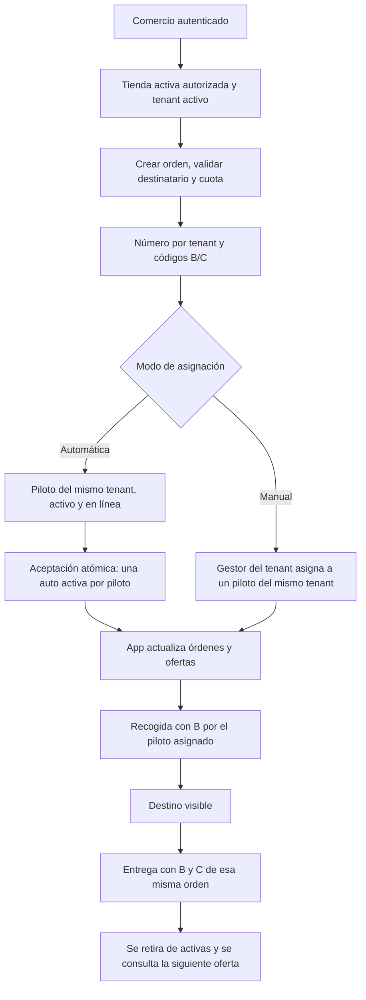

# PilotGo: sesión, recepción de órdenes y aislamiento por tenant

Fecha: 9 de noviembre de 2026, America/Santo_Domingo.

Este informe registra la primera validación local. La entrega posterior con
códigos de cuatro dígitos, migración y APK firmado está en
[RELEASE-1.1.0.md](RELEASE-1.1.0.md).

Se revisaron el backend ASP.NET Core de este repositorio y la app Flutter en
`C:\Users\Fernelis\Desktop\pilotGOapp`. Las correcciones son locales. No se
actualizó el servidor público, no se modificó su base de datos y no se instaló
la app en un teléfono. Rama del backend: `codex/pilotgo-sesion-ordenes-multitenant`.

## Causas encontradas

| Problema | Evidencia en la versión inicial | Corrección |
| --- | --- | --- |
| Las asignaciones manuales aparecen después de volver a iniciar sesión | `PilotoHomeScreen._load()` leía `mis-ordenes` al entrar o volver del detalle; el temporizador solo consultaba `ordenes-auto`. Reiniciar sesión reconstruía la pantalla y volvía a leer las asignaciones. | Consulta de estado, asignaciones y ofertas cada 5 segundos mientras la pantalla está activa. Las asignaciones se consultan también si el piloto desactivó la recepción automática. |
| Se dejan de mostrar nuevas ofertas | `_pollAuto()` terminaba si `_ofertaActual != null`. Una oferta tomada por otro piloto podía quedar visible y detener las siguientes consultas. Además se ignoraban errores, no había timeout ni recuperación explícita al volver del segundo plano. | La oferta visible se contrasta con la lista actual. Se retiran las que ya no existen, se evita superponer consultas y se recupera la consulta al volver a la app o al detalle principal. |
| La sesión deja de funcionar y requiere otro login | Se guardaba el JWT en preferencias, pero no se gestionaban su vencimiento ni los HTTP 401. La configuración actual vence el acceso a las 24 horas. | Renovación mediante refresh token, con un único intento compartido por las solicitudes simultáneas. Un fallo de red conserva la sesión para reintentar. |
| La contraseña no se recuerda | La pantalla inicializaba vacíos los campos y no guardaba credenciales. | Opción visible «Recordar acceso en este teléfono», activada por defecto según lo solicitado. Correo y contraseña se guardan cifrados; desmarcarla borra el acceso recordado. |
| Aceptación de órdenes de otro tenant | El listado automático filtraba `ClienteAppId`, pero el `UPDATE` de aceptación solo comprobaba el ID y estado de la orden. Una llamada directa podía saltarse el filtro. | Tenant, piloto activo, identidad, conexión y disponibilidad se comprueban en el servidor. El rechazo también queda limitado al tenant. |
| Usuarios con varias tiendas provocan un error | El filtro global usaba `SingleOrDefaultAsync` sobre las asignaciones de tiendas del usuario. | Se resuelve la tienda activa autorizada; listar y seleccionar tiendas sigue disponible para salir de una selección revocada. |
| Cambio de tienda inconsistente | `SetTiendaActiva` devolvía un `Task` sin esperarlo; Flutter conservaba el estado de la pantalla anterior. | Se espera el DTO y se reconstruye el contenido al cambiar el ID de tienda. |
| Carreras en asignación y numeración | La lectura y escritura del contador del tenant no estaba serializada. La regla de una entrega automática activa podía ser superada por dos solicitudes simultáneas del mismo piloto. | Contador y cuota se serializan por tenant; aceptación por piloto; las transiciones usan actualizaciones condicionales y transacciones con su historial. |

La primera batería ejecutada antes de las correcciones reprodujo **3 fallos de
6 casos**: aceptación entre tenants, aceptación estando desconectado y acceso
con varias tiendas. El circuito de dos entregas consecutivas ya funcionaba en
el backend al consultarlo directamente: la falta de actualización de pantalla
era un factor distinto al estado guardado de la orden.

## Flujo resultante



Se conserva la regla existente: **un piloto debe terminar su entrega automática
activa antes de aceptar otra automática**. Las asignaciones manuales pueden
ser varias. «En línea» controla la recepción automática; no oculta las órdenes
que ya le hayan asignado manualmente.

El backend comprueba tenant, tienda, destinatario, piloto y estado de la orden.
La dirección, teléfono y enlace de destino se omiten del DTO del piloto hasta
confirmar la recogida. Un 401 o 403 retira los datos cargados del panel del
piloto; los fallos de red muestran el error y permiten recuperar la consulta.

## Persistencia y renovación

- Sesión y credenciales recordadas usan `flutter_secure_storage`; se migran los
  tokens de las preferencias anteriores y se eliminan esas copias. Las nuevas
  claves del almacenamiento se separan por URL del servidor.
- Cerrar sesión borra la sesión local y solicita la revocación del dispositivo.
  Conserva las credenciales solo para volver a rellenar el acceso recordado.
  Desmarcar la opción elimina estas credenciales. Si no hay red al salir, la
  salida local ocurre igualmente; la revocación remota no puede confirmarse.
- `POST /api/auth/refresh` renueva y rota el refresh token. Su vigencia por
  inactividad es de 30 días por defecto, configurable con `Jwt:RefreshDays`.
  La base solo almacena su hash, vencimiento y sello de seguridad, usando
  `AspNetUserTokens`: **no se agregaron migraciones**.
- Cambiar la contraseña o revocar un rol invalida el acceso anterior; renovar
  devuelve los roles actuales. Cerrar un dispositivo no cierra los otros.
- Los tokens antiguos conservan compatibilidad hasta su vencimiento. Para
  obtener el refresh token y guardar la contraseña es necesario un login con
  esta versión del backend y la app. La contraseña recordada debe actualizarse
  después de un cambio de contraseña.
- Las respuestas pendientes de una cuenta anterior no se aplican a la cuenta
  que inicia sesión después.

El componente de almacenamiento documenta cifrado con mecanismos nativos de
cada plataforma; Android utiliza sus cifrados predeterminados y se desactivó
el backup de la app. [Documentación de flutter_secure_storage](https://pub.dev/packages/flutter_secure_storage).
La recuperación de primer plano usa el ciclo de vida de Flutter.
[WidgetsBindingObserver](https://api.flutter.dev/flutter/widgets/WidgetsBindingObserver-class.html).
Las actualizaciones condicionales se agrupan explícitamente con el historial
porque `ExecuteUpdate` no agrupa varias operaciones en una transacción por sí
solo. [Documentación de EF Core](https://learn.microsoft.com/en-us/ef/core/saving/execute-insert-update-delete).

## Pruebas ejecutadas

| Capa | Resultado y cobertura |
| --- | --- |
| API HTTP + SQLite relacional | 19/19: dos órdenes automáticas completas con el mismo login; órdenes manuales sucesivas; cruces de tenant; piloto desconectado/inactivo; varias tiendas; tenant suspendido; concurrencia, cuota y numeración; QR ajenos y visibilidad del destino; vencimiento, rotación, revocación y cambios de contraseña/rol; flujo completo automático y manual reutilizando el mismo servicio. |
| API HTTP + SQL Server LocalDB | 19/19 con la misma batería. Se usaron bases efímeras `PilotGoTest_*` en una instancia propia. Bases e instancia eliminadas al terminar. |
| Flutter | 16/16 pruebas de controladores, red y widgets: sesión al reiniciar, contraseña recordada, olvido voluntario, renovación concurrente, recuperación de red, timeout, respuestas de otra sesión, migración de preferencias, órdenes manuales en pantalla, ofertas retiradas, segunda entrega, pausa/reanudación, acceso revocado y cambio de tienda. El almacén nativo se simula en estas pruebas. |
| Análisis y compilación | `flutter analyze` sin incidencias; `dotnet build Login.sln --no-restore` correcto. APK Android de depuración compilado. |

Evidencia resumida: `docs/qa/validacion-20261109.json`. Los TRX completos quedan
en `Login.Tests/TestResults/`, ignorados por Git. La prueba original de Flutter
solo comprobaba `1 + 1 == 2`; fue sustituida por pruebas del comportamiento real.

Comandos de reproducción:

```powershell
# Backend, desde la raíz de este repositorio
dotnet test Login.sln

# Opcional: SQL Server local y aislado; requiere SQL Server LocalDB
SqlLocalDB create PilotGoCodexQA_20261109
SqlLocalDB start PilotGoCodexQA_20261109
$env:PILOTGO_TEST_SQLSERVER = '1'
dotnet test Login.sln
Remove-Item Env:\PILOTGO_TEST_SQLSERVER
SqlLocalDB stop PilotGoCodexQA_20261109
SqlLocalDB delete PilotGoCodexQA_20261109

# App, desde C:\Users\Fernelis\Desktop\pilotGOapp
flutter analyze
flutter test
flutter build apk --debug
```

## Entrega y límites comprobados

Para que la corrección llegue a los usuarios se debe actualizar **primero el
backend y después la app**. Este trabajo no realizó ese despliegue. El APK es de depuración y usa
la URL configurada en `ApiConfig`; para QA aislado se puede compilar con
`--dart-define=API_BASE_URL=http://servidor-de-pruebas:5008`.

No existe SignalR, WebSocket ni FCM en este flujo móvil. Las actualizaciones
son consultas HTTP periódicas con la app abierta y una consulta al volver a
ella. **No se certifica recepción con la app cerrada, notificaciones push,
funcionamiento del GPS con pantalla bloqueada ni persistencia nativa en un
teléfono físico**. Eso requiere la siguiente prueba en dispositivo y, para
recepción cerrada, implementar el canal push.

La tienda activa sigue siendo una preferencia por usuario en el backend. Si
se usa la misma cuenta de comercio en varios dispositivos, cambiar esa
preferencia afecta sus siguientes consultas. Las pertenencias siguen
validándose; una selección independiente por dispositivo requeriría agregar
un contexto de tienda explícito a cada sesión o solicitud.

Prueba manual sugerida después de actualizar un entorno de QA: iniciar un
piloto, entregar una orden automática y recibir la segunda; asignar dos órdenes
manuales mientras permanece en la pantalla principal; suspender/reanudar la
app; perder y recuperar red; cerrar y abrir el proceso; cerrar sesión y revisar
el acceso recordado; repetir con dos tenants y confirmar que no se cruzan
órdenes. Estas acciones no se ejecutaron contra el servidor público.

La app no tenía repositorio Git. Antes de editar se guardó su código y
configuración relevante en
`C:\Users\Fernelis\Desktop\pilotGOapp-backup-20261109-sesion-ordenes`.
Flutter ajustó archivos generados y flags de compatibilidad de Gradle para el
SDK instalado. Los avisos de futura obsolescencia de Gradle/AGP/Kotlin no
impidieron compilar; no se realizó una actualización mayor de esos componentes.
