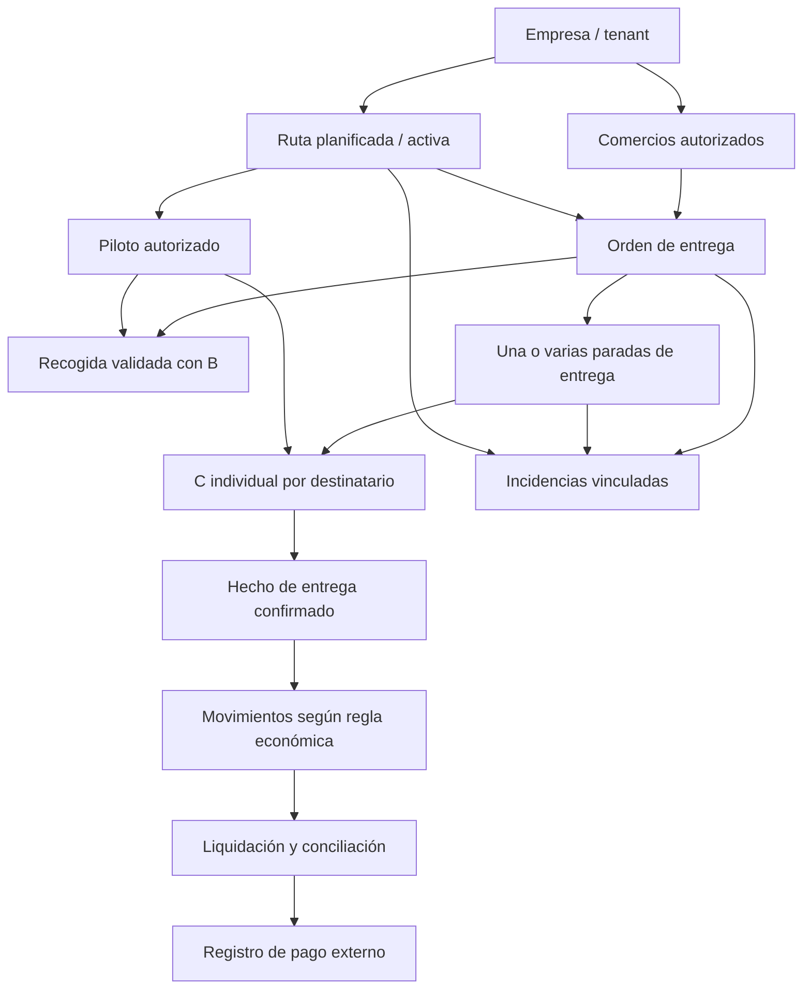

# Envirapido: análisis consolidado y plan de integración

Fecha: 11 de noviembre de 2026, America/Santo_Domingo.

El [lote de publicación autorizado el 12/11/2026](PUBLICACION-GITHUB-20261112.md)
identifica la rama de ambos repositorios, el cliente compatible y los requisitos
para el agente de despliegue. Los recibos anteriores conservan su momento de QA;
la publicación de código no acredita un despliegue de producción.

La [actualización a .NET 10 y QA del 12/11/2026](NET10-ACTUALIZACION-20261112.md)
registra runtime 10.0.15, SQL Server 231/231, Flutter 93/93, continuidad de
sesiones y recepción manual/automática comprobada en el emulador. No hubo push
ni despliegue público. La [guía de despliegue](NET10-DESPLIEGUE.md) conserva las
comprobaciones que todavía exige el servidor real.

La [superadministración SaaS y QA del 12/11/2026](SUPERADMIN-SAAS-20261112.md)
registra empresas, planes, pagos externos, vencimiento, solicitudes, auditoría,
permisos y revisión visual: SQL Server 221/221, Flutter 93/93. El pase real de
producción sigue pendiente; su observación histórica de .NET 8 queda superada
en el proyecto local por el recibo .NET 10 anterior, sin acreditar el alojamiento público.

La [recepción de varias órdenes por piloto — 12/11/2026](MULTIPLES-ORDENES-20261112.md)
registra el nuevo permiso para varias automáticas y manuales activas, conservando
multitenant y secuencia de rutas, con SQL 169/169, Flutter 93/93 y APK QA 2.0.0+8.

La [corrección de recepción y vista deslizante del 12/11/2026](CORRECCION-RECEPCION-Y-VISTA-20261112.md)
registra la unificación del entorno del navegador y emulador, el estilo restaurado,
SQL 163/163, Flutter 89/89 y el APK QA 2.0.0+7.

Este documento conserva el análisis y diseño iniciales. La implementación local
ya está en curso; su evidencia y pendientes se registran por separado en
[Implementación y validación local](IMPLEMENTACION-LOCAL.md). El plan y el catálogo
no equivalen a una aprobación de todas las funciones. No se ha publicado en
GitHub ni desplegado el servidor durante esta etapa.

## 1. Base revisada y documentos

| Componente | Base local comprobada |
| --- | --- |
| Backend / panel | `36d15c7696f1b0a8018251cbcdd6be9897ae7248` |
| Flutter | `8ca95af1ea7c2481be73e38d7abf3c0156ceaae9` |
| Rama en ambos | `codex/confiabilidad-panel-app` |
| Estado inicial | Ambos checkouts limpios antes de esta documentación |

Documentos complementarios:

- [Corrección de los 23 hallazgos — 12/11/2026](CORRECCION-23-HALLAZGOS-20261112.md):
  cambios aplicados, SQL 158/158, Flutter 86/86, Node 5/5, APK QA y alcance de la
  validación nativa GPS; conserva separados los pendientes físicos y de producción.
- [Auditoría de todos los procesos — 12/11/2026](AUDITORIA-FLUJOS-20261112.md):
  defectos reproducidos, brechas de las seis referencias, cobertura y orden de corrección.
- [Catálogo de vistas y acciones](CATALOGO-VISTAS.md).
- [Modelo, contratos y migración](MODELO-Y-CONTRATOS.md).
- [App y sincronización](APP-Y-SINCRONIZACION.md).
- [Plan de pruebas y criterios de salida](PLAN-PRUEBAS.md).
- [Manifiesto de las seis imágenes](REFERENCIAS.json), con tamaño y SHA-256.
- [Comprobación documental](VALIDACION-DOCUMENTAL.json): enlaces, referencias y
  estructura revisados; no contiene un PASS de las funciones nuevas.

Las pruebas anteriores de PilotGo 1.2.0 figuran en
[su recibo](../qa/confiabilidad-1.2.0.json). Son evidencia de aquella base, no
pruebas ejecutadas de Envirapido ni acreditación de sus módulos nuevos.

## 2. Decisiones confirmadas por el usuario

| ID | Decisión | Consecuencia para la integración |
| --- | --- | --- |
| D01 | Nombre visible **Envirapido**. | Actualizar identidad visible en panel y app. Los nombres de las imágenes son referencias, no la nueva marca. |
| D02 | Conservar comercio → orden → CRM → asignación automática o manual → piloto → entrega. | La evolución debe mantener funcional la entrega simple y la recepción sucesiva sin otro login. |
| D03 | Cada empresa opera exclusivamente sus datos; administración global aparte. | Centro operativo y liquidaciones por tenant. Una selección geográfica nunca amplía permisos. |
| D04 | Una orden por escalas contiene varios destinatarios con un mismo piloto. | La orden tiene varias paradas de entrega; no convertir automáticamente cada destinatario en una orden independiente. |
| D05 | Cada destinatario/parada tiene su C. Finalizar pide únicamente C. | Identificar orden y parada y validar piloto, tenant y estado. B conserva su función de recogida. |
| D06 | Conservar el formato A/B/C y los códigos ya emitidos. | No cambiar códigos históricos ni usar sus cuatro dígitos como identificador permanente. |
| D07 | Una ruta puede agrupar una o varias órdenes de la misma empresa. | Mantener identidades de ruta, orden y parada; un piloto autorizado ejecuta el recorrido. |
| D08 | Reordenar paradas solo según permisos y reglas configurables. | Guardar revisión, autor y motivo; preservar identidades, C y recogidas necesarias. |
| D09 | GPS durante rutas/entregas activas, también con pantalla bloqueada o Waze/Maps. | La temporización de una pantalla Flutter es insuficiente; diseñar seguimiento Android dedicado y comprobarlo físicamente. |
| D10 | Conservar el estilo actual de la app; añadir Ruta, Entregas, Ganancias y Perfil. | Adaptar mapas, tarjetas y paradas al estilo Flutter existente, sin sustituirlo por el teléfono del mockup. |
| D11 | Sección para reportar incidencias desde la app del piloto. | Reporte vinculado a su ruta/orden/parada, seguimiento y reflejo en CRM. |
| D12 | Efecto de la incidencia según tipo, mediante reglas configurables. | Puede permitir continuar o pausar una parada/ruta. Atención y entrega tienen estados independientes. |
| D13 | Foto, firma y comprobante quedan opacos y sin funcionar para después. | Mostrar reserva «Próximamente». No capturar, subir, prometer disponibilidad al entregar ni bloquear C por evidencia ausente. |
| D14 | Pagos fuera de Envirapido; registrar y conciliar. | No integrar ejecución de transferencias en este alcance. Programar una fecha no confirma un pago. |
| D15 | Remuneración configurable por servicio, ruta o parada. | Cada partida conserva su origen y la versión de la regla utilizada; evitar duplicidades. |
| D16 | Diseñar vistas adicionales según función y mismo estilo. | Derivar formularios, detalles y recorridos completos; distinguir propuesta derivada de pantalla aportada. |
| D17 | Ampliar la base de datos cuando resulte necesario. | Migración evolutiva y compatible, conservando datos y reglas heredadas. |
| D18 | Envíos simples y de provincia a provincia. | Cobertura y servicio deben contemplarlos sin introducir traspasos entre pilotos que no se han solicitado. |

La imagen I3 se confirmó después de una corrección en la conversación: está
incluida en el alcance. La única excepción funcional expresamente aplazada en
las referencias es D13.

## 3. Alcance visual completo

| Referencia | Pantalla principal | Integración requerida |
| --- | --- | --- |
| [I1](referencias/01-operaciones.png) | Centro de operaciones. | Monitoreo, despacho, rutas, automatización, historial, métricas, mapa, cola y entregas. |
| [I2](referencias/02-detalle-pedido.png) | Detalle desde «Ver». | Resumen, seguimiento, historial, evidencias reservadas, costos, piloto, datos del envío y acciones. |
| [I3](referencias/03-pedidos.png) | Pedidos. | Tabla, filtros, selección múltiple, etiquetas, importaciones, exportaciones, programados, cancelación y devoluciones. |
| [I4](referencias/04-rutas-y-zonas.png) | Rutas y zonas. | Crear/planificar ruta, polígonos, cobertura, capacidad, paradas y ejecución. |
| [I5](referencias/05-incidencias.png) | Bandeja y atención. | Registro desde CRM/app, responsables, plazos, notas, escalaciones y resolución. |
| [I6](referencias/06-liquidaciones.png) | Liquidaciones. | Repartidores, comercios, conciliación, historial, reglas y Ganancias del piloto. |

Aplicar estructura, jerarquía, colores, iconos y acciones de las referencias.
Extraer la paleta exacta desde las copias conservadas durante el diseño visual;
los nombres de color del catálogo no constituyen una medición de valores HEX.
Las cifras, nombres y estados de ejemplo se sustituyen por datos reales
autorizados. «En tiempo real» depende de la conexión y frescura efectivas.

Las pantallas que no tienen referencia propia —Resumen, Repartidores,
Comercios, Reportes, Usuarios y permisos, Configuración y formularios internos—
se diseñan con la misma identidad, completando su función. El catálogo distingue
esas propuestas de las seis pantallas suministradas.

## 4. Modelo lógico central

**Ruta, orden, punto de recogida y parada de entrega son conceptos distintos.**
La ruta puede recoger en varios comercios, pero cada B sigue perteneciendo a su
orden. Los C corresponden a los destinatarios de esa orden. Una dependencia
recogida → entregas evita enviar al piloto a entregar un paquete no recogido.

El progreso de entregas cuenta paradas de entrega confirmadas. Si una pantalla
cuenta también recogidas como visitas, debe decirlo y exponer ambos conteos;
no mezclar órdenes, visitas y entregas bajo un mismo contador.

### Recorrido simple conservado

1. Comercio autorizado crea una orden con un destinatario.
2. CRM recibe una orden, con idempotencia y códigos conservados.
3. La vía automática ofrece trabajo al piloto; la manual asigna mediante un
   usuario autorizado. No sustituir aceptación por asignación directa sin regla.
4. Piloto recibe el trabajo en la misma sesión.
5. B confirma la recogida y desbloquea el destino según la política actual.
6. C confirma esa parada. Para una orden simple, completa su única entrega.
7. App, comercio, CRM y métricas convergen al mismo resultado confirmado.

### Recorrido con escalas y agrupación de órdenes

1. El comercio crea una orden con varios destinatarios y datos congelados.
2. Se genera C por parada; la orden conserva su referencia permanente.
3. El gestor puede incorporarla a una ruta junto a otras órdenes de su empresa.
4. La asignación de ruta y órdenes mantiene un único piloto coherente. Una ruta
   planificada puede existir sin piloto; planificar no equivale a aceptar trabajo.
5. La secuencia respeta recogidas B y reordenamientos permitidos.
6. Cada C completa solamente su parada. Repetir la operación recupera su resultado.
7. El padre refleja el avance real. Incidencias, devoluciones y cancelaciones
   parciales necesitan un cierre explícito; no simular entrega completa.

## 5. Reglas heredadas que se conservan

- Identidad, tenant, rol, comercio activo autorizado y pertenencia del recurso
  se comprueban en servidor en lecturas y escrituras.
- Conservar suspensión/vencimiento, cuotas y reglas de altas/bajas. Un módulo
  nuevo no crea una vía alternativa para eludirlas.
- Destinos ocultos antes de B: el CRM autorizado puede planificar el recorrido
  completo, pero la proyección del piloto no puede revelarlos en JSON, mapas,
  polilíneas, enlaces, exportaciones ni caché antes de recoger esa orden.
- Los códigos conservan ceros iniciales. La validación usa IDs permanentes,
  asignación y estado; un C de otra parada o tenant nunca basta.
- La reserva activa actual es por tenant/tipo. Cuatro dígitos tienen espacio
  finito: el generador actual recorre 10.000 posibilidades. Debe manejar agotamiento
  sin bucles ni duplicados y sin relajar silenciosamente esa regla.
- Conservar creación recuperable, snapshots, renovación de sesión, contraseña
  recordada opcional, sincronización al reanudar y recepción manual con auto apagado.
- La recepción automática y el seguimiento GPS son capacidades separadas.
- Preservar paquete Android, firma y URL pública al cambiar la marca visible,
  salvo una decisión futura expresa que requiera otra estrategia de distribución.

## 6. Estados y hechos independientes

| Dimensión | Qué representa | Qué no debe implicar automáticamente |
| --- | --- | --- |
| Entrega de una parada | Recogida habilitante, tránsito, llegada y confirmación C. | Cobro, liquidación o pago. |
| Orden | Agregado de sus paradas y situación de custodia. | Entrega total tras la primera parada. |
| Ruta | Plan, piloto, secuencia y ejecución. | Aceptación de órdenes o modificación de sus códigos. |
| Demora | Incumplimiento de un compromiso temporal definido. | Pérdida de la etapa «En ruta». |
| Incidencia | Nueva, en atención, escalada y resolución. | Entregar/cancelar ni borrar el estado físico del paquete. |
| Conciliación | Correspondencia entre movimientos y cantidades verificadas. | Pago confirmado. |
| Liquidación | Composición, revisión y aprobación de partidas. | Transferencia ejecutada. |
| Pago | Registro verificable de un pago externo. | Pago por alcanzar una fecha programada. |

Los nombres definitivos y sus transiciones se especifican en contratos y
pruebas. No reutilizar comparaciones numéricas como `estado >= Entregada`.
Los estados adicionales conservan la interpretación de los registros históricos.

## 7. Decisiones pendientes y propuestas para resolverlas

Estas propuestas **no son decisiones ya tomadas por el usuario**. Deben cerrarse
antes de activar la parte afectada. No impiden construir primero la base compatible.

| Pendiente | Propuesta de trabajo | Momento de cierre |
| --- | --- | --- |
| «Pendiente» frente a «Por asignar». | Pendiente como espera de validación/programación; por asignar como lista sin piloto. Las órdenes actuales seguirían entrando listas. | Antes del nuevo listado/agenda. |
| «Recogido» frente a «En ruta». | Registrar hitos reales y sus acciones; conservar la experiencia simple sin inventar una segunda hora. | Antes del seguimiento nuevo. |
| Recogidas por orden. | Mantener una recogida comercial por orden; varias recogidas en una ruta provienen de sus distintas órdenes. | Antes de publicar creación multiparada. |
| Devolución, cancelación y parada fallida. | Conservar entregas ya confirmadas y custodia; acción con motivo y cierre explícito por parada/orden. | Antes de esos comandos. |
| Reasignación tras recogida. | Mantener al piloto custodio hasta una regla explícita; no introducir transferencias entre pilotos por conveniencia técnica. | Antes de permitir esa reasignación. |
| SLA, prioridad y escalación. | Reglas versionadas de compromiso, atención/resolución, pausas y efecto operativo; sin plazos inventados desde el mockup. | Antes de alertas/detección automática. |
| Capacidad de zona y solapamientos. | Definir unidad, horarios, carga real y precedencia geográfica. Mantener capacidad operativa separada de cuota SaaS. | Antes de automatizar decisiones geográficas. |
| Autoasignación de rutas. | Preservar oferta/aceptación actual; definir capacidad antes de permitir varias automáticas agrupadas. | Antes de automatización avanzada. |
| Cuotas en orden multiparada/programada. | Identificar órdenes y paradas por separado; no multiplicar ni posponer consumo sin decisión comercial. | Antes de activar esas altas. |
| Tarifas y remuneración. | Configurar base, componentes, vigencia, redondeo y unidad. Definir parciales, cancelaciones y retornos. | Antes de emitir partidas/liquidaciones. |
| Efectivo de comercios. | Registrar esperado/declarado/verificado, responsable, compensación y diferencias; definir qué hacer con saldo negativo. | Antes de conciliación real. |
| Permisos financieros e incidencias. | Matriz por acción. No conceder aprobación, ajuste o resolución al piloto por crear una vista. | Antes de exponer escrituras. |
| Importaciones y etiquetas. | Plantilla con agrupación de destinatarios, validación previa, errores por fila y reanudación; no imprimir C en etiquetas operativas del piloto. | Antes de importación/impresión. |
| Proveedor/costo de ruta y retención GPS. | Evaluar capacidades, tráfico, presupuesto, muestreo y retención. No activar consumo facturable desde esta revisión. | Antes de integración y seguimiento de producción. |

## 8. Estrategia de integración

Conservar ASP.NET Core/EF Core 8, SQL Server y Flutter como base. La referencia
no requiere por sí misma reescribir el sistema ni actualizar de framework.
Separar servicios de dominio y consultas de las pantallas para que CRM y app
observen las mismas reglas.

### Compatibilidad y despliegue

1. Añadir el esquema y adaptar órdenes existentes a una parada equivalente,
   conservando ID, A/B/C, estado, precio, fechas e historial.
2. Mantener contratos antiguos para operaciones que realmente pueden representar.
   Negociar capacidades/versiones para multiparada, C por parada y rutas.
3. Un cliente viejo no debe recibir trabajo que no sabe ejecutar ni validar C
   contra una parada implícita equivocada. La app nueva tampoco supondrá soporte
   de un servidor viejo.
4. Aplicar primero backend/base compatibles, después cliente y activación por
   tenant. Activar una función no amplía permisos.
5. Ensayar restauración/rollback antes de producción. Después de crear datos
   multiparada, un binario anterior no es una recuperación válida por sí solo.

Los secretos y firmas existentes permanecen fuera del repositorio. No publicar
configuración, cuentas bancarias completas ni códigos privados en logs o URLs.

### Concurrencia y actualización

Usar comandos idempotentes, versiones de recursos y restricciones de base de
datos según el modelo propuesto. Cambiar una ruta, asignación o liquidación
desde una pantalla desactualizada debe dar un resultado explícito, no pisar
silenciosamente el trabajo de otro usuario. SQL Server dispone de tokens
`rowversion`; SQLite requiere otra estrategia de token para pruebas equivalentes.
[Referencia oficial de concurrencia EF Core](https://learn.microsoft.com/en-us/ef/core/saving/concurrency).

Un filtro por tenant puede ayudar a proteger consultas, pero la propuesta mantiene
también autorización por recurso, validación de escritura y relaciones coherentes
en base de datos. Revisar llamadas que omitan filtros y procesos en segundo plano.
[Guía oficial de multitenancy EF Core](https://learn.microsoft.com/en-us/ef/core/miscellaneous/multitenancy).

### Rutas y estimaciones

Calcular un recorrido vial, reordenar paradas y optimizar una flota son problemas
distintos. La documentación de Google describe ordenación de waypoints en Routes
y un servicio específico que contempla flotas, recogidas, entregas y restricciones.
Esto confirma opciones técnicas, no una contratación ni selección definitiva.
La secuencia sugerida debe respetar permisos, precedencias y paradas ya realizadas.
[Routes](https://developers.google.com/maps/documentation/routes/opt-way),
[Route Optimization](https://developers.google.com/maps/documentation/route-optimization/overview).

Si no existe una estimación válida, mostrar su indisponibilidad y frescura real.
No convertir distancia recta o un fallo de proveedor en un ETA confiable.

## 9. Lotes de implementación propuestos

Cada lote requiere recorrer backend, CRM y app en lo que afecte. Las pantallas de
un lote incompleto no se anuncian como módulos publicados. La excepción visual
autorizada para evidencias permanece identificada como futura.

| Lote | Resultado revisable | Dependencia y salida |
| --- | --- | --- |
| L0 | Contratos, matriz de permisos, estados y fixtures de referencia cerrados. | Resolver pendientes del lote que sigue; conservar baseline y copias. |
| L1 | Parada única compatible y finalización con C, manteniendo B en recogida. | Migración ensayada; órdenes antiguas y flujo simple pasan de extremo a extremo. |
| L2 | Comercio crea orden multiparada; CRM y piloto ejecutan cada destinatario. | C individual, reintentos, progreso parcial y privacidad comprobados. |
| L3 | Marca, navegación app y Centro de operaciones/Detalle/Pedidos con datos reales. | Diseño fiel, comandos conectados, métricas coherentes y permisos. |
| L4 | Zonas, creación/ejecución de rutas y GPS activo con pantalla bloqueada. | Precedencias, revisiones, ETA, ahorro de recursos y recorrido físico. |
| L5 | Incidencias completas en CRM y app. | Reglas, responsables, plazos, notas, escalaciones y resolución sin entregar por error. |
| L6 | Movimientos, liquidaciones, conciliación, pagos externos y Ganancias. | Reglas versionadas, sin duplicidades y saldos explicables. |
| L7 | Agenda, importaciones, etiquetas, devoluciones, reportes y vistas derivadas restantes. | Todos los menús y acciones completan su función; reglas comerciales definidas. |
| L8 | QA integral, piloto operativo controlado y entrega de versión. | Evidencia visual, SQL, físico, migración y checklist de despliegue. |

El orden puede ajustar dependencias internas; por ejemplo, crear incidencias
antes de exponer devoluciones. No sacrificar seguridad ni una prueba del flujo
simple para completar primero la apariencia del dashboard.

El catálogo contiene 45 grupos de vistas y recorridos. El plan enumera 50
escenarios funcionales y ocho recorridos físicos de GPS, todos pendientes de
ejecución cuando exista la implementación. Las seis referencias conservan sus
bytes y hashes originales.

## 10. Criterio de finalización

La entrega se considera implementada cuando todas las vistas activadas operan
con datos reales, las políticas se verifican en servidor, el flujo simple y el
multiparada pasan, una empresa no observa a otra, las incidencias no corrompen
entregas y la contabilidad conserva origen y estados verificables.

La validación incluye SQL Server, Flutter, navegador y teléfono Android real;
el emulador no reemplaza GPS con pantalla bloqueada, navegación externa,
reconexión, batería y permisos en un Samsung. Ver el
[plan de pruebas](PLAN-PRUEBAS.md). Los resultados futuros se registrarán con su
SHA, entorno y alcance; no se promete perfección de producción a partir de mocks.
