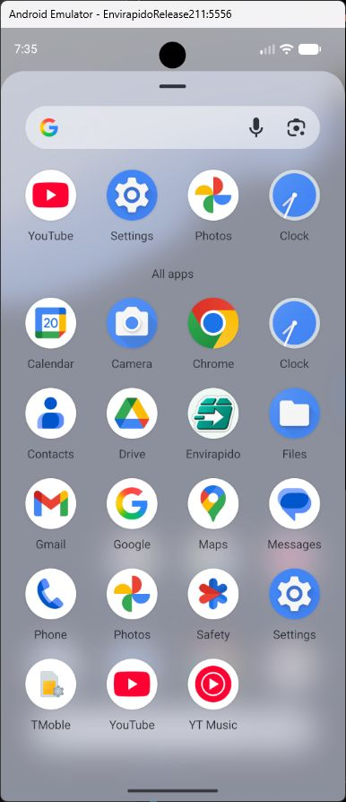

# QA de retiros desde incidencias — entrega 2.1.1

La validación funcional local terminó con **371/371 pruebas SQL Server**, incluidas 25 regresiones nuevas, **129/129 pruebas Flutter** y analizador sin problemas. No hubo fallos ni omitidas en la suite SQL final aislada. Los recibos anteriores se conservan con su alcance; no representan una nueva ejecución de producción.

El código funcional de esta entrega coincide por SHA256 con las fuentes validadas. Después sólo se actualizaron versión Android y documentación de entrega. El APK release se compiló desde el commit móvil limpio `ba9411c461da82d137a6fc6121daf8b0c50f4b21`; las fuentes y sus hashes raw/blobs Git constan en [su recibo](../../envirapido/APK-2.1.1-11.json).

Las nuevas pruebas SQL cubren:

- Incidencia y solicitud atómicas, aprobación/rechazo, retirada antes y después de recoger, custodia y recepción por el receptor autorizado.
- Selección de paradas, cancelación, conservación de códigos, parada hermana y actualización del trabajo activo del piloto.
- Límites de empresa, roles, CSRF, revisión de asignación, concurrencia, rollback e idempotencia de contratos anteriores.
- Traslado explícito del conjunto versionado de devoluciones clásicas y conservación de historial sin recepción fingida.
- Pausa de ruta que se conserva tras retirar membresías; selección que contradice una pausa por parada rechazada sin conversión parcial.
- Solicitud HTTP desde una orden clásica con revisión nula o vacía y recuperación del mismo intento.

El recorrido visual usó CRM y APK debug QA contra la misma base SQL local ficticia. Se observó retirada sin B/C, aprobación sin relogin, reparto/cancelación por parada, traslado clásico y recepción desde la cuenta del piloto receptor. La verificación directa SQL confirmó C sin consumir y custodia correcta. No se modificaron pedidos reales, cobros, pagos ni el Samsung.

Ese APK QA precede a dos ajustes finales de historial/contexto; cuatro regresiones widget cubren esas ramas. La inspección y apertura del nuevo APK release se registran por separado en su recibo. La firma, una apertura del login o una prueba local no equivalen a validar el flujo completo contra producción.

El release 2.1.1 (11) pasó firma definitiva, alineación 16 KiB, identidad y URL en las tres ABI. Se instaló en el emulador independiente `EnvirapidoRelease211`: su SHA256 instalado coincide con el archivo firmado y se observaron la caja y el login sin entrar a producción. `dotnet publish -c Release` también terminó correctamente. La siguiente captura muestra el launcher de ese binario:

Los hashes de las evidencias están en `resultados.json`. Los logs originales, capturas y bases ficticias se conservan localmente bajo `artifacts/retiros-integrados-20261119/` y el directorio de build móvil. No se publican bases ni credenciales.

Para desplegar y completar la QA pública, seguir [DESPLEGAR-ENVIRAPIDO-2.1.1.md](../../../DESPLEGAR-ENVIRAPIDO-2.1.1.md).
